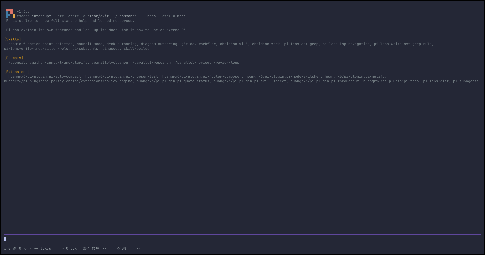
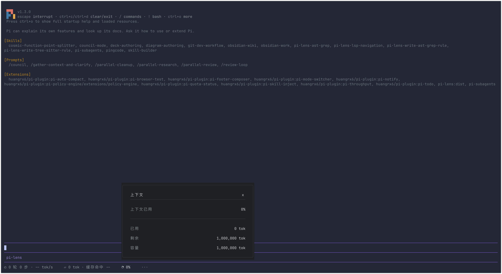

# pi-footer-composer

把会话统计、Token 用量和上下文占用收进一行底栏，需要时点击查看详情。同一时间只展开一张卡片，日常保持简洁。

摘要靠左，上方是一条与输入框同主题的分隔线，常规终端共占两行：

```text
◴ 1 轮 77 步 · 249 tok/s     ▱ 7.3M tok · 缓存命中 99%     ◔ 16%     ···
```

## 界面预览

**收起状态**：常驻摘要，上方保留对话和输入区。



**展开上下文**：点击上下文入口，查看占用比例、已用、剩余与容量。



截图来自空会话，因此用量为 0，尚未产生的速度和缓存命中率显示为 `--`。图片保留原始分辨率，可点开查看细节。

## 查看与收起

| 摘要入口 | 详情 |
| --- | --- |
| 会话轮次、步骤、速度 | 模型用时、工具用时、首 Token 平均延迟、输出速度 |
| Token 总量、缓存命中 | 精确 Token 数、缓存读取与写入、输入与输出、费用 |
| 上下文百分比 | 当前上下文占用、已用、剩余、容量 |
| `···` 更多 | 模型、提供方、思考等级，以及自行配置的状态、额度、诊断等 |

点击一个入口打开卡片，点击另一个入口直接切换。再次点击当前入口、按 Esc 或点击卡片右上角的 `ｘ` 即可收起；普通左键点击面板外或继续编辑也会收起。切走终端时自动收起需要终端上报焦点变化。

长内容在卡片内用滚轮查看，标题与关闭按钮固定。诊断等长列表自动换行，续行沿同一左边界排列；字段之间留白，额度等短记录保持右对齐。浮层不占用对话布局。打开时临时接管键盘，Esc 只关闭当前面板；继续编辑时先恢复输入框，再处理本次输入，不丢失字符。

鼠标交互需要支持组件鼠标事件的 Pi 全屏模式。普通终端可使用下面的命令；缺少浮层接口时回退到宿主详情对话框。

## 安装与使用

```bash
pi install "$PWD"
```

执行 `/reload`。首次启动生成配置：

```text
<agent-dir>/extensions-data/pi-footer-composer/config.json
```

`<agent-dir>` 跟随 `PI_CODING_AGENT_DIR`，默认 `~/.pi/agent`。

| 命令 | 行为 |
| --- | --- |
| `/footer` | 打开详情、模式与配置菜单 |
| `/footer stats` | 会话用时、TTFT、TPS |
| `/footer tokens` | 精确 Token 数、缓存命中率、费用 |
| `/footer context` | 上下文用量、容量和剩余量 |
| `/footer more` | 模型信息与配置的外部状态 |
| `/footer close` | 关闭当前浮层 |
| `/footer custom` / `native` | 切换自定义 / 原生底栏并保存 |
| `/footer reload` | 校验并应用配置，失败时保留当前显示 |

旧 `compact` / `overview` 命令均映射到 `custom`，`toggle` / `expand` 打开或切换会话统计卡片，`collapse` 关闭。会话启动和配置重载时默认关闭浮层，点击不写配置。

## 数据含义

- **轮 / 步**：当前分支的用户消息数 / assistant 消息数；失败调用也计为一步。
- **TPS**：成功调用的供应商输出 Token 总和 ÷ 同一批调用从首个非空内容增量到结束的总时长，扣除首 Token 等待。仅纳入输出不少于 100 Token、首 Token 后窗口不少于 100 毫秒的调用；缺少输出量或首 Token 计时的调用不参与，不按文本长度估算。首内容可以是思考或工具参数；隐藏推理未流式上报时，此数值仍是近似速度。
- **TTFT**：请求到首个非空文本、思考或工具参数增量的平均时长。失败、取消和没有内容增量的调用不参与平均。
- **模型 / 工具用时**：成功模型调用的端到端时长之和 / 各次工具派发到结束的时长之和。并行工具耗时可重叠。
- **Token**：当前分支累计未缓存输入、缓存读取、缓存写入和输出，含摘要及额外用量；缓存命中率为缓存读取 ÷ 全部输入的加权比例。
- **上下文**：宿主提供的当前用量与容量；尚未结算时显示 `--`。没有可靠来源的细分类别不绘制占比。

摘要数值取整或缩写，详情保留精确 Token 数和一位百分比。用量累计与上下文占用是不同指标。计时记录随宿主会话保存；旧会话缺少计时时显示 `--` 和覆盖范围，不反推历史速度。

## 配置与显示

窄终端会逐级缩短摘要，极窄时保留更多入口，仍可通过命令打开任一卡片。选中项只提亮文字，卡片采用适配深浅主题的中性灰背景。设置 `icons: "ascii"` 可将图标和边框换为 ASCII。

默认“更多”展示模型信息；状态、额度和诊断等内容需要在 `more.sections` 配置对应的精确状态 key，按配置顺序显示。隐藏项不会从未映射内容中再次出现；显式开启 `more.includeUnmapped` 后，其余状态归入“其他”。配置示例见下方参考。

状态文本保留原意，只做颜色清理、换行和对齐，不从文本推算错误数量或额度。旧版项目与策略项在迁移时默认隐藏，可按需重新配置。

升级时自动备份旧配置并迁移，说明见 [配置参考](CONFIG.md)。其他资料：[示例](examples/config.json)、[Schema](schema/config.schema.json)、[设计](DESIGN.md)、[更新记录](CHANGELOG.md)。

## 开发

```bash
npm ci
npm run check
npm test
```
